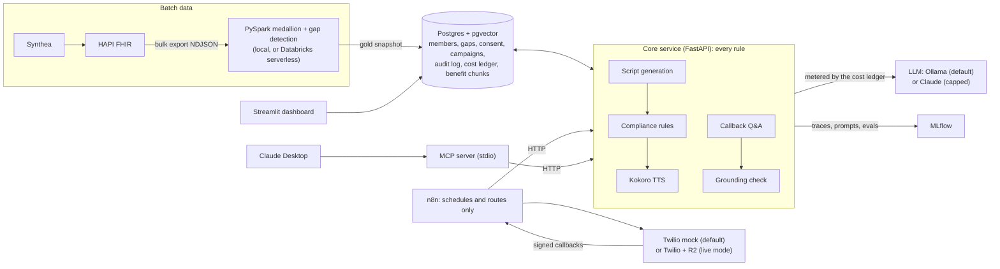

# CareGap Voice

A deployable voice outreach agent for health plan care gaps: it finds members with open
gaps (annual wellness visit, diabetic eye exam, statin adherence), generates a compliant
outreach script, renders it to speech, places the call, and answers inbound callback
questions from plan benefit documents.

> **All data is synthetic.** Members are generated with [Synthea](https://synthetichealth.github.io/synthea/).
> There is no real PHI anywhere in this repository, its fixtures, or its demo recordings.

**Status:** all 12 phases built. See [PROGRESS.md](PROGRESS.md) and the [results](#results).

## Design goals

- **Local first, near-zero cost.** The default stack runs entirely in docker compose:
  Ollama for the LLM, Kokoro for TTS, faster-whisper for STT, a local Twilio mock.
  Paid APIs are optional and sit behind a hard budget cap (`LLM_BUDGET_USD`, default $5).
- **Measured, not claimed.** Rule-based evals, LLM-as-a-judge calibrated against human
  labels, round-trip WER for voice, hallucination analysis for RAG.
- **Config-driven multi-tenancy.** Two customer configs drive every behavior difference.

## Quick start

Requires Docker with Compose v2, [uv](https://docs.astral.sh/uv/), GNU make, Java 17+
(for the PySpark pipeline) and about 30 GB of free disk (images about 15 GB, data about
9 GB). The first run downloads images and models and takes about 45 minutes, most of it
`make seed`.

```bash
git clone https://github.com/ameyabhamare/caregap-voice.git && cd caregap-voice
make install            # Python deps + pre-commit hooks (first run builds PySpark: a few minutes)
make up                 # creates .env from .env.example; starts every service, waits until healthy
make seed               # ~2,000 synthetic members + 23 edge cases -> HAPI FHIR -> NDJSON (~20 min)
make pipeline           # bronze/silver/gold + care-gap detection with local PySpark
make sync-gaps          # members and care gaps into Postgres
make pull-model         # qwen2.5:3b + nomic-embed-text into Ollama (~2.3 GB)
make prompts-register   # prompts/*.yaml -> MLflow prompt registry ("production")
make ingest-benefits    # each plan's Summary of Benefits -> pgvector
make run-campaign       # 20-member campaign end to end: n8n -> core service -> Twilio mock
```

`make run-campaign` prints each member's outcome (about 10-15 minutes on CPU). Then try
`make dashboard` (http://localhost:8501) or `make run-campaign CUSTOMER=horizon`.
Everything runs locally at $0. Running it for a plan (adding customers, rotating keys,
failures, rollbacks) is in [docs/RUNBOOK.md](docs/RUNBOOK.md).

More commands (`make help` lists all):

```bash
make check        # lint, typecheck, unit tests (CI runs these plus integration and the eval gate)
make test-all     # adds integration tests against the running stack
make eval         # script eval suite (rules + judge + reading level), logged to MLflow
make eval-rag CUSTOMER=sunrise  # callback Q&A hallucination report
make eval-voice   # TTS -> STT round trip: WER, drug/plan name accuracy
make eval-ci      # the CI eval gate: replay recorded fixtures, check thresholds
make validate-config  # check customers/*.yaml
make serve        # core service on the host (dev; compose also runs it as `core`)
```

| Service    | URL                          |
|------------|------------------------------|
| Postgres   | `localhost:5432` (caregap/caregap) |
| MLflow     | http://localhost:5000        |
| Ollama     | http://localhost:11434       |
| HAPI FHIR  | http://localhost:8080/fhir   |
| Core service | http://localhost:8000 (docs at `/docs`) |
| n8n        | http://localhost:5678        |
| Twilio mock | http://localhost:8100 (`/mock/calls` lists calls) |

HAPI FHIR takes about a minute to become healthy on first start.

## How it works

### Synthetic members

`make seed` generates members with a pinned Synthea release and fixed seeds, adds
simulated statin pharmacy fills (Synthea has none) and 23 hand-built edge-case members
with known expected gaps ([fixtures/edge_cases/members.yaml](fixtures/edge_cases/members.yaml)),
loads them into HAPI FHIR, bulk-exports NDJSON to `data/export/` and validates the export.
`make seed-verify` proves the run is reproducible. Use `SEED_POPULATION=20 make seed` for
a quick run. See [ADR 0003](docs/adr/0003-synthetic-data-pipeline.md).

### Gap detection

`make pipeline` runs the medallion pipeline locally (Parquet under `data/lake/`) and
detects three care gaps for measurement year 2025: annual wellness visit, diabetic eye
exam and statin adherence (PDC). `make sync-gaps` loads members and gaps into Postgres
(`members`, `care_gaps`). The first `uv sync` builds PySpark from source, which takes a
few minutes.

The same code runs on **Databricks Free Edition** as a serverless job writing Delta
tables in Unity Catalog ([ADR 0004](docs/adr/0004-gap-detection-pipeline.md)):

1. Install the [Databricks CLI](https://docs.databricks.com/dev-tools/cli/install.html).
2. Set `DATABRICKS_HOST` and `DATABRICKS_TOKEN` in `.env` (or use a CLI profile).
3. `make pipeline-databricks`: deploys the bundle, uploads the NDJSON to a volume, runs
   the job, downloads the gold snapshot and syncs it into Postgres.

### Outreach scripts and compliance

`POST /scripts {"member_id": ...}` writes a short spoken script for a member's open gaps
with the local model, checks it against deterministic compliance rules (verbatim
disclaimer and opt-out, length, no personal details, no diagnosis or drug names), revises
once with the violations as feedback, and otherwise queues it for human review
(`GET /reviews`, `POST /reviews/{id}`). Only the member's first name reaches the model.
Prompts are versioned in MLflow's prompt registry. See
[ADR 0005](docs/adr/0005-generation-and-compliance.md).

### Voice

Scripts are rendered with **Kokoro** (local, via ONNX Runtime) on request
(`POST /scripts/{id}/audio`). Drug and plan names use a pronunciation override dictionary
([voice/pronunciations.yaml](voice/pronunciations.yaml)). A round-trip eval transcribes the
audio with faster-whisper and measures word error rate. See
[ADR 0006](docs/adr/0006-tts-strategy.md).

| Round-trip result (Kokoro af_heart, Whisper small.en) | Without overrides | With overrides |
|---|---|---|
| Outreach scripts, corpus WER (100 scripts) | - | 2.3% |
| Medication names transcribed exactly (44) | 54.5% | 88.6% |
| Plan names transcribed exactly (13) | 100% | 100% |

### Campaigns (orchestration)

`make run-campaign` creates a campaign for 20 members with open gaps and drives it through
**n8n** to a local **Twilio mock**. Every decision (consent, call window, first-N human
approval, retries, opt-out, escalation) is made by the core service; n8n only schedules,
routes and calls its API, and a test keeps it that way. Twilio callbacks are
signature-checked. Alerts and escalations go to a Slack-compatible webhook (default: a
local log at `data/notifications.log`). See
[ADR 0007](docs/adr/0007-orchestration-n8n-and-twilio-mock.md).

```
selected -> skipped (deceased / no consent / revoked / bad phone)
         -> script -> held for a human (first 5, or failed compliance) -> approved
         -> call (09:00-20:00 local, Mon-Sat) -> completed | opted out (9) | escalated (0)
         -> no answer / busy / failed -> retry (max 3 calls) -> failed + alert
```

Two runs of 20 members each at Phase 5, with outreach prompt v1 (qwen2.5:3b, Kokoro,
mock telephony; about 11 minutes each, dominated by local generation). The run with the
current prompt is in [Results](#results).

| | Default mock outcomes | `--cover-outcomes` (every call path) |
|---|---|---|
| Skipped at selection | 1 (consent revoked) | 4 (2 bad phone, 1 revoked, 1 unknown consent) |
| Scripts held for a human | 14 (3 first-N, 11 failed compliance) | 7 (4 first-N, 3 failed compliance) |
| Calls placed | 12 (8 completed, 4 no answer, retried) | 21 (10 completed, 5 no answer, 3 busy, 3 failed) |
| Final | 8 completed, 11 waiting on review | 6 completed, 3 opted out, 1 escalated, 3 failed after 3 calls, 3 waiting on review |
| Escalations delivered | 0 | 4 (3 delivery failures, 1 call-back request) |

Compliance failures are all the dropped-disclaimer issue of prompt v1, kept as the
Phase 8 baseline.
`make run-campaign CAMPAIGN_ARGS=--cover-outcomes` exercises every call path (script
generation is not deterministic, so counts vary between runs).

The demo clock (`CAMPAIGN_CLOCK` in `.env`) puts the service inside the call window
whatever the real time is; leave it empty to use real time. Edit workflows in the n8n UI
and `make n8n-export` them back into `n8n/workflows/`.

### Customers

Each health plan is one YAML file in [customers/](customers), validated at startup and by
`make validate-config` (schema and cross-checks in
[src/caregap/customers.py](src/caregap/customers.py); see
[ADR 0008](docs/adr/0008-customer-configs.md)). Horizon was added in a commit that
changes only `customers/horizon.yaml`.

| | Sunrise Medicare Advantage | Horizon ACA Marketplace |
|---|---|---|
| Members | 65 and over | under 65 |
| Care gaps | wellness visit, eye exam, statin refills | eye exam, statin refills |
| Languages | English, Spanish (`ef_dora`) | English |
| Voice | `af_heart` | `am_michael` |
| Member data in prompts | first name | none (generic greeting) |
| Calls | Mon-Sat 9-20, up to 3 calls, opt out with 9 | Mon-Fri 10-19, up to 2 calls, opt out with 8 |
| Human approval | first 5 per campaign | first 3 per campaign |

```bash
make run-campaign CUSTOMER=horizon
make eval-rules N=100 CUSTOMER=horizon
make eval-rules N=30 CUSTOMER=sunrise LANGUAGE=es
```

Rule-based compliance at Phase 6, with outreach prompt v1 (qwen2.5:3b, `make eval-rules`;
current numbers in [Results](#results)):

| Customer (sample) | First attempt | Final (after one revision) |
|---|---|---|
| Sunrise, 100 members (94 English, 6 Spanish) | 27% | 67% |
| Sunrise, Spanish only (20 members) | 85% | 100% |
| Horizon, all 72 members with gaps | 75% | 100% |

These are not a controlled comparison: prompts, wording and members all differ. Sunrise
English failures are still prompt v1's dropped disclaimer (the Phase 8 baseline). The rule
checks do not cover register: 16 of 20 Spanish scripts use informal "tú" although the
prompt asks for "usted".

### Callback questions (RAG)

`POST /callbacks/questions {customer, question}` answers a member's question from their
own plan's synthetic Summary of Benefits ([benefits/](benefits), PDFs generated from the
markdown next to them), or hands it to a person. The flow is route (model) -> retrieve
(pgvector, one benefit line per chunk, never across plans) -> answer with citations
(model) -> a grounding check without a model: every amount must be in a cited line and
no other plan may be named. Medical, member-specific and off-topic questions are refused
and escalated. See [ADR 0009](docs/adr/0009-callback-rag-and-grounding.md).

Golden Q&A: [fixtures/qa/](fixtures/qa) (48 Sunrise questions, 6 in Spanish; 40 Horizon).
Final run, qwen2.5:3b + nomic-embed-text (MLflow `rag-evals` a4f8d19e, ec154846):

| | Sunrise | Horizon |
|---|---|---|
| Answerable questions answered correctly | 78.8% | 66.7% |
| Should-refuse questions refused (medical, member, off-topic, not in document) | 100% | 100% |
| Answerable but handed off (over-refusal) | 21.2% | 30.0% |
| Spoken answers with a wrong amount or another plan's facts | 0% | 0% |
| Same, for the model's raw drafts before the check | 0% | 4.3% |
| Router accuracy / retrieval hit rate | 91.7% / 100% | 90.0% / 100% |

How it got there (one change per run): over-refusal started at 70% because the router
called cost questions "medical"; router v2 and v3 and line-level chunks brought it down
and removed same-section amount mix-ups; an answer-prompt change made both customers
worse and was rolled back. Amount checks do not catch wrong statements without numbers:
a manual review of the 49 spoken answers found 2 such errors (one contradicts the
document, one adds "no copay"); the Phase 8 judge is meant to catch those.

### Evals, prompt iteration and CI

- **Judge**: a local LLM judge rates every outreach script for clarity, tone and medical
  advice (pass/fail); reading level is computed (Flesch-Kincaid, grade 8 or below).
  Calibration: the owner labels 50 scripts ([fixtures/judge/calibration.csv](fixtures/judge/calibration.csv),
  `make label-judge`); `make judge-agreement` reports Cohen's kappa per criterion.
  Result against the owner's 50 labels: clarity 66% agreement (kappa -0.08; the judge
  missed all 15 scripts the owner failed), tone 98% (kappa 0; the judge never fails
  tone), no medical advice 100% (the owner passed all 50). The local 3B judge is
  reported, not trusted: no judge criterion gates CI.
- **Prompt iteration** (`make prompts-candidate`, `make eval ALIAS=candidate`): every
  version is one MLflow run (`eval-suite`) over Sunrise, Sunrise Spanish and Horizon,
  and is promoted only if mean final compliance improves with no guard regression.

  | outreach-script | Change | Mean final pass | Mean first attempt | Decision |
  |---|---|---|---|---|
  | v1 | baseline | 89.3% | 62.7% | production |
  | v2 | "two sentences" -> "three" | 91.7% | 72.7% | rejected: judged medical-advice failures 57 -> 63 |
  | v3 | no health claims ("important for your health") | **99.7%** | **84.0%** | **promoted** |
  | v4 | v3 + "three sentences" | 97.3% | 80.3% | rejected: worse |

  v3 took Sunrise from 68% to 99% final and 28% to 92% first-attempt compliance.
- **CI** ([.github/workflows/ci.yml](.github/workflows/ci.yml)): lint, types, unit tests,
  Postgres integration tests, and an eval gate that replays model responses recorded at
  dev time (`make record-fixtures`; CI never calls a model). Gates: script compliance per
  configuration, callback Q&A with zero spoken hallucinations and 95% refusals.
- **Reports**: [reports/sunrise.md](reports/sunrise.md), [reports/horizon.md](reports/horizon.md)
  (and `.json`), regenerated by `make record-fixtures`. `make eval-ci` writes its replay to
  `data/ci-reports/` (CI uploads it as an artifact) and leaves these alone.

See [ADR 0010](docs/adr/0010-evals-judge-and-ci-gate.md).

### MCP server (Claude Desktop)

The core service is also an MCP server, so Claude Desktop can work with care gaps:
`get_member_gaps`, `search_benefits`, `log_interaction` and `escalate_to_human`. It runs
over stdio on your computer (`make mcp-config` prints the Claude Desktop entry). An agent
sees only the member fields and measures the plan allows. Escalations go to the same
outbox as the campaigns, and n8n delivers them with IDs only. Setup and a walkthrough are
in [docs/mcp.md](docs/mcp.md); the design is in [ADR 0011](docs/adr/0011-mcp-integration-surface.md).

### Observability and governance

- **Traces**: every core operation (preparing a member's script, rendering audio,
  answering a callback question, a benefit search) is one MLflow trace in the
  `caregap-traces` experiment. Model calls, embeddings, compliance checks, retrieval, the
  grounding check and TTS are spans inside it, tagged with customer, campaign and member.
  `MLFLOW_TRACING=true` in compose; never in tests or CI.
- **Audit log**: an append-only `audit_log` table records every generated message (prompt
  versions, model, rule results, reading grade, cost, trace), every review (the
  approver), audio, call, keypress, escalation and agent interaction.
  `make trace-member CAMPAIGN=1 MEMBER=<id>` prints one member's path from script to audio
  to call outcome.
- **Cost and latency**: each script and callback answer stores the cost of its model
  calls (Decimal; $0 on local models). A `stage_latency` view gives p50/p95 per stage.
- **Dashboard**: `make dashboard` (http://localhost:8501) has five tabs: campaign funnel,
  eval pass rates and WER, cost against the budget, latency per stage, and "trace a
  member".

See [ADR 0012](docs/adr/0012-observability-and-audit.md).

### Live demo mode (optional)

Off by default; the stack stays local at $0. With a Twilio trial and an R2 bucket,
[docs/live-demo.md](docs/live-demo.md) walks through one real call to your verified phone:
- `make live-up` starts the tunnel;
- `make live-call` asks you to approve the script, then calls;
- `make live-recording` saves the recording.

It also covers inbound callback calls (ask a benefits question by voice) and the
cost-capped Claude-vs-local comparison (`make eval-compare`).

Guards:
- One public route: the tunnel reaches only an edge filter for Twilio's webhook.
- Audio is served through short-lived signed R2 URLs.
- Calls go only to allowlisted numbers, and only up to a call cap.
- The core service refuses to start half-configured.

See [ADR 0013](docs/adr/0013-live-mode-trust-boundary.md).

## Architecture



- **Batch data**: Synthea members are loaded into HAPI FHIR and bulk-exported. One
  PySpark codebase runs locally (default) or as a Databricks serverless job and writes a
  gold snapshot that `make sync-gaps` loads into Postgres.
- **Core service**: every decision (consent, call window, approval, retries, compliance,
  grounding) lives here. n8n and the MCP server are thin layers over its HTTP API.
- **Cost**: every model call goes through the cost ledger. Local calls are $0; paid
  calls stop at `LLM_BUDGET_USD`.

Design decisions are recorded in [docs/adr](docs/adr):
[local-first cost](docs/adr/0002-local-first-cost-design.md),
[synthetic data](docs/adr/0003-synthetic-data-pipeline.md),
[Databricks for batch data](docs/adr/0004-gap-detection-pipeline.md),
[generation and compliance](docs/adr/0005-generation-and-compliance.md),
[TTS](docs/adr/0006-tts-strategy.md),
[n8n for orchestration only](docs/adr/0007-orchestration-n8n-and-twilio-mock.md),
[customer configs](docs/adr/0008-customer-configs.md),
[RAG and grounding](docs/adr/0009-callback-rag-and-grounding.md),
[evals and CI](docs/adr/0010-evals-judge-and-ci-gate.md),
[MCP](docs/adr/0011-mcp-integration-surface.md),
[observability](docs/adr/0012-observability-and-audit.md),
[Twilio/R2 trust boundary](docs/adr/0013-live-mode-trust-boundary.md),
[PHI handling](docs/adr/0014-phi-handling.md).

## Results

All numbers are on synthetic members with the local stack (qwen2.5:3b, nomic-embed-text,
Kokoro, Whisper small.en) unless marked Claude. Generation is not deterministic, so
reruns vary by a few points.

### Outreach scripts (`make eval`, production prompts, 2026-10-25)

| | Sunrise (100) | Sunrise Spanish (20) | Horizon (72) |
|---|---|---|---|
| Compliant on the first attempt | 89% | 100% | 75% |
| Compliant after one revision | 98% | 100% | 100% |
| Reading grade 8 or below | 100% | n/a | 100% |
| Judge (local, not trusted): all criteria pass | 92% | 35% | 33% |

Scripts that still fail go to a person, never to a call. Prompt history: v3 (no health
claims) raised mean final compliance from 89.3% to 99.7% when promoted; this rebuild
measured 99.3%.

### Callback questions (`make eval-rag`, 2026-10-25)

| | Sunrise (48) | Horizon (40) |
|---|---|---|
| Answerable questions answered correctly | 78.8% | 66.7% |
| Medical, member and off-topic questions handed off | 100% | 100% |
| Answerable but handed off (over-refusal) | 21.2% | 30.0% |
| Spoken answers with a wrong amount or another plan's facts | 0% | 0% |

### Voice (`make eval-voice`, Phase 4)
Script word error rate 2.3% (100 scripts). Drug names transcribed exactly: 54.5% without
the pronunciation overrides, 88.6% with them. Plan names: 100%.

### Campaign (`make run-campaign`)
From a fresh clone following this README (2026-10-25; Sunrise, 20 members, mock
telephony, about 11 minutes):

| | Count |
|---|---|
| Skipped at selection | 2 (1 consent revoked, 1 unknown consent) |
| Scripts held for a person | 5, all first-N approvals; none failed compliance |
| Calls placed | 28 (17 completed, 9 no answer and retried, 2 failed) |
| Final | 15 completed, 1 opted out, 1 escalated (pressed 0), 1 failed after 3 calls |
| Escalations delivered | 2 (1 call-back request, 1 not reached) |

At Phase 5, with prompt v1, 11 of 20 scripts failed compliance and waited on a person.

### CI eval gate
CI replays model responses recorded at dev time and fails if script compliance drops
below 94-95% per configuration, if any spoken callback answer is ungrounded, or if
refusal accuracy drops below 95% ([reports/](reports)).

### Demo recording
Pending: the real call to the owner's phone has not been made yet
([docs/live-demo.md](docs/live-demo.md)).

### Claude vs the local model (`make eval-compare`, 2026-10-25)

claude-sonnet-5-5 against local qwen2.5:3b, both using the same members, production
prompts, golden questions and checks. Full tables: [docs/results/claude-vs-local.md](docs/results/claude-vs-local.md).

| | local qwen2.5:3b | claude-sonnet-5-5 |
|---|---|---|
| Scripts compliant on first attempt (Sunrise / Sunrise ES / Horizon) | 89% / 100% / 75% | 99% / 100% / 64% |
| Scripts compliant after one revision | 98% / 100% / 100% | 99% / 100% / 100% |
| Callback answers correct (Sunrise / Horizon) | 79% / 67% | 100% / 97% |
| Callback over-refusals (Sunrise / Horizon) | 21% / 30% | 0% / 0% |
| Spoken hallucinations | 0% | 0% |
| Latency p50, script / answer | 10-14 s / 10 s | about 2 s / 2 s |
| Cost (192 scripts + 88 questions) | $0 | $0.88 |

How to read it:
- The grounding check keeps spoken hallucinations at 0% for both models. Claude's gain is
  answering instead of handing off: it was over-refusing 0% of the time vs 21-30% locally.
- Horizon first attempts fail more often on Claude, all on `max_length`; one revision
  fixes every one.
- Judge scores are left out here. The judge is the uncalibrated local model (no
  criterion reaches kappa 0.4), so its numbers are reported only in the full tables.
- Local latency is on CPU in a container. A GPU would narrow the gap.

## Limitations

Honest list, roughly by how much it matters:

- **Not ready for real PHI.** No authentication on any service (they bind to
  localhost), no encryption at rest, no BAAs, no retention rules. What real data would
  need is in [ADR 0014](docs/adr/0014-phi-handling.md).
- **Live mode is untested against real services.** Twilio, R2 and the tunnel have only
  been exercised against the Twilio mock and a fake R2.
- **The LLM judge is not trusted.** Against the owner's 50 labels no criterion reaches
  kappa 0.4. It fails most Spanish and Horizon scripts the rules pass, so it is reported
  but gates nothing.
- **Grounding checks amounts, not meaning.** A wrong statement without a number (for
  example "no referral needed") passes. A manual review at Phase 7 found 2 such errors
  in 49 spoken answers.
- **The local model over-refuses** 21-30% of answerable callback questions. Claude
  removes that (0%) at about $0.003 per answer.
- **Spanish**: round-trip WER is not measured (Whisper small.en is English-only), and
  at Phase 6 most Spanish scripts used informal "tú" although the prompt asks for
  "usted". The rules do not check register.
- **Horizon scripts are near-duplicates** (about 5 distinct texts for 72 members): no
  name in its prompt and a fixed seed.
- **Gap detection is simplified.** Three measures, written from the definitions in
  `fixtures/edge_cases/members.yaml`, not certified HEDIS logic. Statin fills are
  simulated, because Synthea has none.
- **The Twilio mock only presses 9 or 0**, so Horizon's opt-out digit (8) is covered by
  tests, not by the mock.
- **Speed**: on CPU a script takes 10-14 s and a callback answer about 10 s, which is
  close to Twilio's ~15 s inbound timeout.
- **Synthetic consent and membership.** Consent is generated (90% granted) and plan
  membership is assigned by age.
